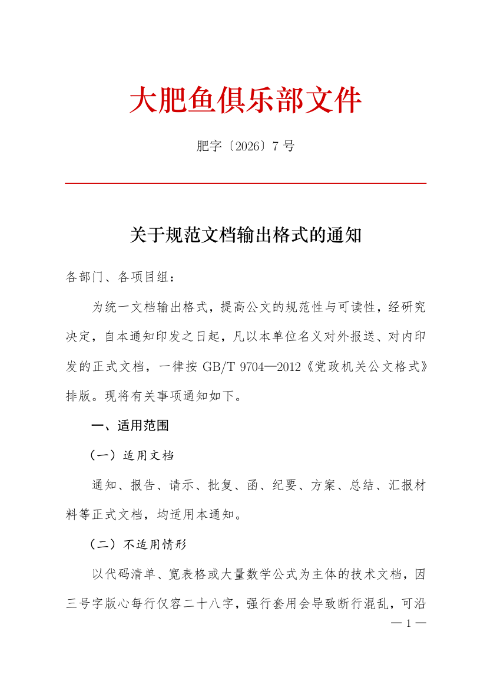

# 关于公文格式 DSH 插件的项目说明



## 一、项目概况

中文公文的版式由 GB/T 9704—2012《党政机关公文格式》规定，参数琐碎且相互牵连：
固定行距 28 磅、三号字折合 16 磅、首行缩进两字折合 640 twips、发文机关标志须为红色小标宋、
页码须单页居右双页居左。任一处记错，整份文件即不合规。

本插件把上述机械部分固定为代码，由三个原生工具承担。内容组织、文种选择与措辞规范
仍由使用者判断，插件不作干预。

## 二、功能构成

| 工具 | 作用 | 外部依赖 |
|---|---|---|
| `gongwen_docx` | 生成符合国标的 DOCX | 无，纯 JavaScript 实现 |
| `gongwen_pdf` | 生成符合国标的 PDF | 本机需装 TeX Live（xelatex） |
| `gongwen_check` | 校验既有 DOCX 或 PDF 的版面 | 无 |

## 三、安装与加载

### （一）前置条件

| 项目 | 要求 | 说明 |
|---|---|---|
| DSH | 0.2.x | 插件依 cordis 规范加载 |
| Node.js | 20 及以上 | DSH 自带运行时即可 |
| TeX Live | 可选 | 仅 `gongwen_pdf` 需要；不装只影响 PDF 工具 |
| 中文字体 | 仿宋、黑体、楷体、宋体 | Windows 自带；macOS 与 Linux 会降级 |

DOCX 与校验两项功能不依赖任何外部程序，装完即可用。

### （二）安装步骤

自本仓库安装时，执行以下四步。

其一，取得源码并放到固定位置：

```
git clone git@github.com:longaotiandedage/dsh-tool-gongwen.git ~/dsh-tool-gongwen
```

其二，进入 profile 目录，以本地路径安装：

```
cd ~/.dsh/profiles/desktop
pnpm add "file:$HOME/dsh-tool-gongwen"
```

其三，在该目录的 `package.json` 中登记模块名。`dsh.profile.bundles` 数组里追加一项：

```json
{
  "dsh": {
    "profile": {
      "bundles": [
        "dsh-tool-gongwen"
      ]
    }
  }
}
```

其四，重启 DSH。若已开启热加载，保存后等待片刻亦可。

若日后发布至 npm，则第二步改为 `pnpm add dsh-tool-gongwen`，其余不变。

### （三）验证安装

重启后在会话中提出如下要求，若工具可用即安装成功：

```
用 gongwen_docx 生成一份关于××的通知，输出到 test.docx
```

生成后用 `gongwen_check` 校验，应返回"符合 GB/T 9704—2012"。

### （四）卸载

从 `dsh.profile.bundles` 中删除 `"dsh-tool-gongwen"`，再执行
`pnpm remove dsh-tool-gongwen`，重启即可。插件不写入任何全局路径。

## 四、使用方法

### （一）生成 DOCX

```
gongwen_docx({
  org: "华中科技大学教务处文件",
  docno: "教字〔2026〕15 号",
  title: "关于开展数值方法课程资源建设的通知",
  to: "各教学单位：",
  blocks: [
    { type: "body", text: "为加强……现将有关事项通知如下。" },
    { type: "h1", text: "一、建设目标" },
    { type: "h2", text: "（一）总体要求" },
    { type: "h3", text: "1. 讲义建设" }
  ],
  attachments: ["1. 任务分工表", "2. 体例说明"],
  signOrg: "华中科技大学教务处",
  signDate: "2026年10月26日",
  output: "notice.docx"
})
```

### （二）生成 PDF

参数与上节相同，仅将 `output` 改为 `.pdf`。

### （三）版面校验

```
gongwen_check({ path: "notice.docx" })
```

输出为逐项对照表：

```
项目                    实测      国标   判定
页面宽                  210     210   OK
上白边（天头）               37      37   OK
版心宽                  156     156   OK
正文字号                  16      16   OK pt
行距                    28      28   OK pt
奇偶页不同页码                1       1   OK
结论：符合 GB/T 9704—2012
```

## 五、内容规格

| 字段 | 必需 | 说明 |
|---|---|---|
| `org` | 否 | 发文机关标志，红色小标宋、居中 |
| `orgBold` | 否 | 版头是否加粗，默认否 |
| `docno` | 否 | 发文字号，其后自动加红色分隔线 |
| `title` | 建议 | 文件标题，二号小标宋、居中 |
| `to` | 否 | 主送机关，顶格 |
| `blocks` | 是 | 正文块序列 |
| `attachments` | 否 | 附件说明，首行左空二字，续行左空五字 |
| `signOrg` | 否 | 发文机关署名，居中于成文日期之上 |
| `signDate` | 否 | 成文日期，右空二字 |
| `output` | 是 | 输出路径，相对路径按会话工作目录解析 |

正文块类型有五：`h1` 为一级标题（形如「一、」，三号黑体）、`h2` 为二级标题
（形如「（一）」，三号楷体）、`h3` 为三级标题（形如「1.」，三号仿宋加粗）、
`to` 为主送机关、`body` 为普通段落。

## 六、技术实现

版式参数须换算为 OOXML 单位方可写入：长度用 twips（1/20 磅），字号用半磅。
换算关系列表如下。

| 项目 | 数值 | OOXML 写法 |
|---|---|---|
| 页面 | A4，210 × 297 mm | `<w:pgSz w:w="11906" w:h="16838"/>` |
| 天头 | 37 mm | `w:top="2098"` |
| 订口 | 28 mm | `w:left="1587"` |
| 右白边 | 26 mm | `w:right="1474"` |
| 下白边 | 35 mm | `w:bottom="1984"` |
| 正文 | 三号仿宋 16 磅 | `<w:sz w:val="32"/>` |
| 行距 | 固定 28 磅 | `w:line="560" w:lineRule="exact"` |
| 首行缩进 | 2 字 | `w:firstLine="640"` |

长度换算为 1 毫米等于 56.6929 twips，由 `mm()` 函数统一处理。
字号换算为 1 磅等于 2 个半磅单位，故三号字写作 32。

DOCX 生成与 ZIP 读写均自行实现，见 `lib/zip.js` 与 `lib/docx.js`，
除 Node 内置模块外不引入任何依赖。作此取舍的原因在于：插件运行于使用者的
DSH 安装目录之内，多一项依赖即多一处安装失败的可能。

## 七、校验能力与边界

DOCX 的校验读取 `sectPr` 与 `styles.xml`，所得为精确值，可覆盖页面尺寸、
四边白边、版心、正文字号、行距与奇偶页设置。

PDF 的校验仅能读取页面尺寸，方法为解压对象流后读取 `MediaBox`。四边白边需
文字坐标，本插件不引入 PDF 解析器，须改用配套技能的
`scripts/verify_layout.py`（依赖 PyMuPDF）。

### 自检脚本

仓库自带自检，不依赖 DSH 运行时，装完可直接运行：

```
node test/selftest.mjs
```

覆盖 ZIP 读写往返、DOCX 生成与版面回读、PDF 生成与页面尺寸、报告格式。
未装 TeX Live 时 PDF 一项自动跳过，其余照常。

```
  PASS  ZIP 读写往返  — 227 字节，2 个条目
  PASS  生成 DOCX 并校验  — 9911 字节，8 项全部符合国标
  PASS  生成 PDF 并校验  — 38401 字节，页面尺寸符合国标
  PASS  字体  — 正文 = FangSong（仿宋）
  PASS  字体  — 标题 = 华文中宋（替代方正小标宋）
  PASS  报告格式  — 17 行
```

## 八、示例性质与法律提示

`examples/` 中的通知为排版示例，其中机构名称、发文字号、日期与联系方式均属虚构，
不指向任何真实存在的机关、企业或组织，亦不构成任何真实文件。

使用本插件生成正式文件时，请注意以下三点。

其一，不得冒用真实机构的名称与文号。伪造国家机关公文可能触犯《刑法》第二百八十条；
《治安管理处罚法》（2025 年修订，2026 年 1 月 1 日施行）第六十三条对伪造、变造、
买卖国家机关、人民团体、企业事业单位或者其他组织的公文亦有处罚规定。

其二，本插件不生成印章。公文生效依赖真实印章，任何形式的电子伪造印章均不在
本插件能力范围之内。

其三，发布或分发示例文件时，应避免使用已注册的商标或他人已登记的名称。

生成的文件如何使用，由使用者负责。

## 九、许可

MIT 许可，详见 [LICENSE](LICENSE)。
